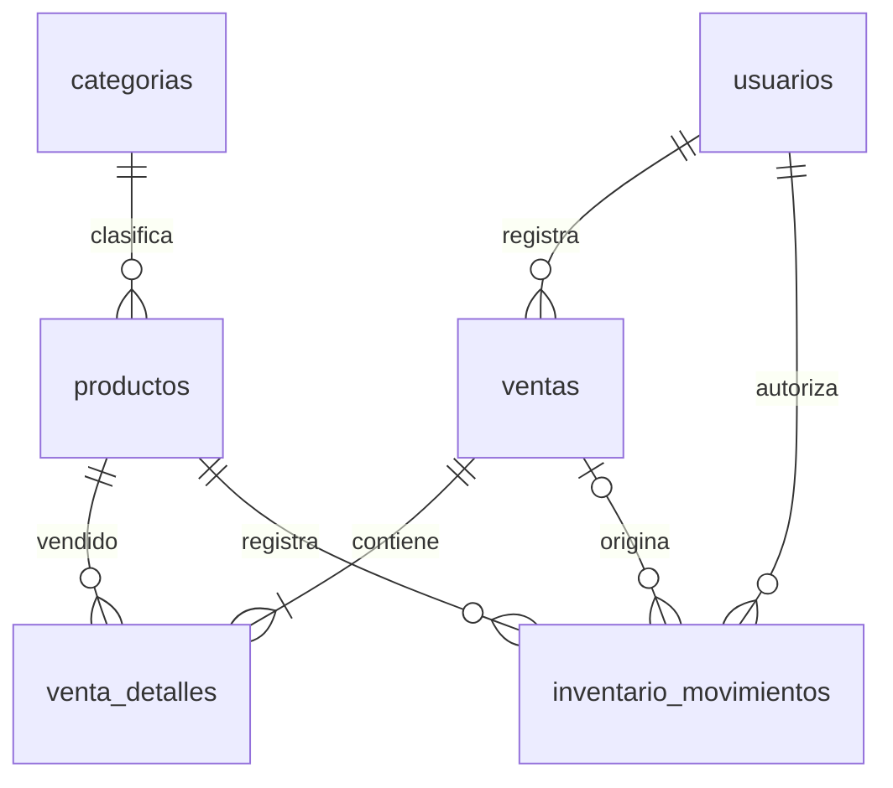

# Base de datos

Importar `schema.sql` en una base vacía y luego `seed.sql`, una sola vez. No son migraciones ni scripts para volver a ejecutar sobre datos existentes. El seed contiene tres categorías y diez productos con stock cero. No crea usuarios ni ventas; usar `scripts/crear_admin.php` para el administrador.

## Relaciones

| Tabla | Propósito |
| --- | --- |
| usuarios | Identidad, email único, hash, rol admin/cajero y estado |
| categorias | Nombre único y estado |
| productos | Código único, categoría, precios DECIMAL(10,2), stock actual y mínimo |
| ventas | Cajero, fecha, total, pago, cambio y estado |
| venta_detalles | Producto, cantidad, precio histórico y subtotal por venta |
| inventario_movimientos | Diferencia de stock, motivo, autor, fecha y venta opcional |

Las claves foráneas usan RESTRICT para conservar el historial. Hay índices por fecha, usuario y producto; los detalles agrupan cada producto una sola vez por venta. La referencia opcional `inventario_movimientos.venta_id` permite rastrear salidas y evita repetir movimientos del mismo tipo para un producto de una venta.

## Contrato de inventario y ventas

`productos.stock_actual` es el saldo oficial. `cantidad` en movimientos representa una diferencia firmada: entrada positiva, salida negativa y ajuste positivo o negativo, nunca cero. Las existencias iniciales deben registrarse como entradas con usuario; el seed comienza en cero para conservar esa consistencia.

La implementación de venta debe:

1. Validar sesión, CSRF, permisos, método de pago y cantidades enteras positivas; agrupar productos repetidos.
2. Abrir transacción PDO y bloquear productos con `SELECT ... FOR UPDATE`, en orden de id para reducir bloqueos cruzados.
3. Comprobar productos activos y stock; calcular precios y totales desde MySQL usando centavos enteros en PHP o aritmética decimal exacta.
4. Insertar venta y detalles, descontar stock una sola vez y crear movimientos de salida negativos asociados a la venta.
5. Confirmar todo con commit o revertir todo con rollback ante cualquier error.

Entradas y ajustes también requieren bloqueo y transacción para actualizar saldo y movimiento juntos. Cancelar una venta exige bloquear su fila y productos, comprobar estado confirmada, restaurar stock, registrar entradas por devolución y cambiar el estado a cancelada en la misma transacción. No borrar ventas ni repetir la reversión.

Las restricciones SQL validan importes positivos, pago y cambio, subtotales y stock no negativo. La igualdad entre total y suma de detalles, la disponibilidad de usuarios/categorías/productos y la consistencia global de movimientos requieren validación transaccional en PHP; el esquema por sí solo no implementa esas operaciones. No hay triggers que descuenten stock.
